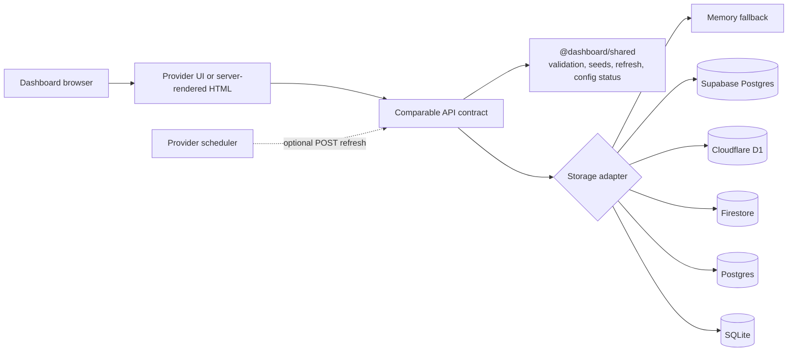

# Architecture

Every module has an intentionally equivalent edge-to-storage flow. Provider adapters vary while widget semantics remain in `@dashboard/shared`.

The add flow validates a three-field request, generates the identifier and timestamp in the backend, persists through the selected adapter, and returns the created widget. Refresh reads all widgets, applies deterministic mocked external values to known seed identifiers, updates timestamps, and writes the set back atomically where the database supports transactions or batches.

Production auth is intentionally outside the comparable core. Supabase includes per-user RLS policies, Firebase includes authenticated-user rules, and every README identifies the authentication layer required before storing private dashboard data.
